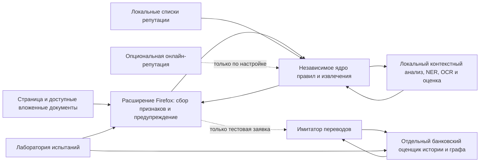

# Техническое задание: браузерная защита платёжных действий и исследовательский стенд

**Версия:** 0.1, рабочая редакция по ответам заказчика от 28.10.2026.  
**Статус:** задание на разработку и исследование; не является описанием уже реализованного продукта.  
**Получатель:** разработчик или ИИ-агент, который реализует систему, выполняет испытания и по фактическому результату пишет документацию продукта, пользователя и разработчика.

## 1. Основание и порядок приоритета

Основание — результаты `payment-guard-decisions-2026-10-28-20-43-06.json` и последующие уточнения заказчика в чате. Машиночитаемая карта принятых решений приведена в файле `decision-traceability.json`, подготовленном вместе с этим документом.

Заказчик подтвердил три разрешения противоречий опроса:

1. Функции F36–F38 исключены **как отдельные пользовательские модули**, но минимальные технические меры обязательны внутри реализуемых компонентов: не сохранять номер карты и CVV, ограничить полномочия локальной модели, фиксировать происхождение данных испытаний. Это не означает скрытого добавления трёх самостоятельных функций продукта.
2. Общая политика защиты — **предупредить и дать выбор**, включая поддерживаемый сценарий перед вводом карточных данных. Не заявлять гарантированную остановку ввода или утечки. Если техническое предупреждение невозможно показать до ввода, зафиксировать это как ограничение и результат испытания, а не подменять «после ввода» на «до».
3. Репутация — вспомогательный сигнал включённых функций: локально обновляемые данные и необязательная онлайн-проверка с минимизацией запроса. Исключённая F10 не восстанавливается как отдельная универсальная функция проверки доменов, TLS и репутации.

При расхождении приоритет имеют: непосредственное уточнение заказчика → явно выбранные в опросе решение, вариант и комментарий → утверждённые общие требования → это техническое описание → ранее сгенерированные рекомендации и метки анкеты. Рекомендация анкеты не является выбранной функцией. При существенном противоречии, которое нельзя разрешить этим порядком, разработчик фиксирует вопрос и не выдаёт предположение за решение заказчика.

Все 27 функций со статусом `include` входят в объём работы. F21 имеет статус `experiment` и должна быть реализована и оценена как исследовательский прототип с соответствующей маркировкой, без заявления о полном производственном охвате. F22, F23, F26 и F33 отложены. F04, F09, F10, F25, F27, F28, F36, F37, F38 и F41 исключены как самостоятельные функции. Не переносить выбранные внутри исключённых функций варианты в реализацию как активные решения.

Приоритеты `essential`, `research` и `useful` сохраняются как отмеченные заказчиком характеристики; значение `research` не является отказом от реализации. Требования к функциональности не исключаются автоматически из-за сроков, навыков или предполагаемой стоимости разработки.

## 2. Назначение и границы продукта

Разработать средство защиты пользователя настольного Firefox при посещении страниц, где возможно финансовое действие, передача платёжных данных или связанное чувствительное согласие. Наблюдение за доступной страницей начинается с лёгкого фонового детектора; более глубокий анализ запускается при выявлении подходящего контекста. Пользователь не обязан заранее планировать покупку или нажать кнопку «Оплатить».

Система должна выявлять выбранные в разделе 8 сценарии, отображать наблюдаемые факты и оценку, объяснять ограничения и предоставлять пользователю решение. Низкая оценка — результат доступных проверок, а не гарантия безопасности. Для недоступных данных предусмотрен отдельный результат «не установлено».

Отдельно разрабатывается исследовательский банковский компонент: модель истории получателя на подходящем транзакционном наборе, сравнение с базовыми моделями и имитатор перевода. Расширение не получает историю реальной карты из браузера и не управляет настоящим банком или банковским приложением. Взаимодействие двух оценщиков демонстрируется на согласованных синтетических случаях.

Не обещать обнаружение всех видов мошенничества, всех чтений полей, всех исходящих утечек, серверных намерений или срабатывание до ввода во всех браузерных компонентах. Доказать покрытие для заявленных конкретных сценариев; неудовлетворённые случаи показать отдельно.

## 3. Пользователи и основные сценарии

**Обычный пользователь** посещает сайт в Firefox и видит пояснение до поддерживаемого платёжного действия, когда это позволяет наблюдаемая последовательность. **Исследователь** сравнивает методы и результаты. **Разработчик** устанавливает расширение и локальные компоненты, запускает испытания и поддерживает модели. **Аналитик стенда** просматривает только синтетические банковские сценарии и причины решений.

Сценарии, которые необходимо реализовать и проверить:

1. Пользователь зашёл на страницу без намерения платить; появилась потенциально финансовая кнопка или форма — система обнаруживает её по доступным сигналам, готовит анализ и различает факт от предположения.
2. Впервые обнаружена поддерживаемая карточная форма. Показать обычное предупреждение до ввода, если это реально произошло; пользователь выбирает продолжение и может отключить **обычное** подтверждение для конкретного продавца. Опасные события не подавляются этим исключением.
3. Страница предлагает получить деньги, а доступный контекст просит совершить исходящий платёж или раскрыть дополнительные сведения. Представить наблюдаемое несоответствие и уровень неопределённости; не утверждать, что всякая привязка карты мошенническая.
4. Предложен ручной перевод или QR: извлечь только доступные поля и сравнить с контекстом. Показать, когда содержимое QR непрозрачно, а получатель или сумма не установлены.
5. На законной странице зафиксирован выбранный технический признак подмены/скрытого элемента/подозрительного действия. Показать конкретное основание и время его обнаружения, не объявлять утечку предотвращённой без соответствующего наблюдения.
6. Пользователь вручную передаёт текст, ссылку или изображение для локальной проверки. Анализ не выполняет реальный платёж, не нажимает кнопки за пользователя и не передаёт материал внешней модели.
7. В демонстрации пользователь принимает решение в браузерном сценарии, затем создаётся **тестовая** заявка, графовая модель оценивает доступную историю синтетического получателя, имитатор исполняет или приостанавливает только смоделированную операцию.

## 4. Архитектура и техническая реализация

### 4.1. Компоненты

1. **Firefox WebExtension**: фоновый обработчик, content scripts в разрешённых документах, настройки, локальный пользовательский интерфейс, безопасное хранение настроек и исключений. Использовать Manifest V3 и зафиксировать целевую версию Firefox при реализации. Проверять выданные разрешения; недоступный контекст обозначать явно.
2. **Независимое ядро анализа**: принимает нормализованные факты и возвращает извлечённые объекты, основания, результат проверки и неопределённость. Не зависит от Firefox DOM напрямую; адаптер расширения преобразует наблюдения в этот формат.
3. **Локальный интеллектуальный компонент**: модели и OCR выполняются на устройстве. Допустим отдельный локальный процесс, подключаемый через Firefox Native Messaging, если выбранная модель не может практически исполняться внутри расширения. Локальный процесс и его манифест устанавливаются отдельно; требуется явная инструкция установки и идентификатор разрешённого расширения. Источник: [Mozilla Native Messaging](https://developer.mozilla.org/en-US/docs/Mozilla/Add-ons/WebExtensions/Native_messaging).
4. **Отдельный графовый оценщик**: на вход принимает тестовую заявку и исторические признаки из выбранного транзакционного набора; не запрашивает сведения о настоящей карте на основе произвольного номера из браузера.
5. **Имитатор**: тестовые счета и заявки, детерминированные состояния, подключаемые результаты веб- и банковского оценщиков. Все реквизиты и остатки в демонстрационных сценариях фиктивны.
6. **Лаборатория**: управляемые локальные страницы, получатели тестовых запросов, воспроизводимые сценарии, наборы данных, метрики и отчёты. Никаких активных атак, отправки форм или денежных операций на посторонних сайтах без отдельного разрешения владельца.

Конкретные библиотеки выбираются после проверки лицензий, доступности, совместимости и запуска на целевом оборудовании. Разрешено использовать Python для локальных моделей/испытаний, TypeScript или JavaScript для Firefox и подходящие библиотеки OCR, AST, графов и ML. Не считать FastAPI, внешнюю LLM, облако, GPU или удалённый сервис обязательным требованием: пользователь выбрал локальную интеллектуальную обработку.

### 4.2. Наблюдение и доверенные границы

- Content script получает доступ только к документам и встроенным контекстам, для которых предоставлены соответствующие разрешения. Зафиксировать ограничения закрытых страниц, встроенных платёжных форм, закрытых shadow roots, автозаполнения и конкретной версии Firefox.
- Финансовые признаки извлекать из доступных подписей, метаданных полей, ролей, связанной формы, текста и наблюдаемых изменений. Чтение значения пользователем не является обязательным для распознавания типа поля.
- Анализ сетевых событий F17 ограничивается метаданными, которые реально доступны при выданных разрешениях и выбранной реализации. Не утверждать содержимое зашифрованного трафика, атрибуцию к скрипту или успешную блокировку на основании одного назначения. Первое сетевое событие может произойти до обнаружения контекста.
- JS анализировать как данные: разбор кода/AST и известных признаков; не выполнять загруженный код в полномочиях расширения или сервиса. Обработка произвольных скриптов ограничена видимыми ресурсами и техническими ограничениями браузера.
- Текст, изображения и данные страницы являются недоверенными. Языковая модель не получает права нажимать кнопки, отправлять формы, давать разрешения, переводить деньги или менять настройки пользователя. Модельные выводы проверять по схеме; указанные идентификаторы оснований должны соответствовать фактически переданным наблюдениям.
- В качестве результата «наблюдалось чтение поля конкретным скриптом» использовать только подтверждённую реально реализованным механизмом атрибуцию. F16 выбрана в варианте событий формы; регистрировать фокус, ввод и изменения без утверждения, что этим зафиксировано каждое чтение JavaScript.

## 5. Поток данных и контракты

### 5.1. Представление сессии и наблюдений

Ввести версионированные структуры данных. Фактические имена полей могут отличаться, но смысл обязателен:

- `session_id`, `page_id`, `frame_id` и `observation_id` — локальные корреляционные идентификаторы, не равные номеру карты или аккаунту; отметки времени и версии компонентов.
- `origin` магазина и, если доступно, отдельный контекст платёжного провайдера. Исключение привязывается к конкретному продавцу и не переносится на другой сайт лишь из-за общего PSP. Если продавца невозможно установить, универсальное доверие провайдеру не применяется.
- `observation_type`, источник и состояние видимости: например, метаданные формы, видимый текст, событие фокуса, разрешённый сетевой метаданный факт, OCR. Если происхождение или атрибуция не подтверждены, значение `unknown`.
- `financial_action`: тип (`purchase`, `receive`, `transfer`, `refund`, `card_verification`, `unknown`), наблюдаемые источники и границы. Общий детектор может заметить подписку как потенциально финансовое действие, однако исключённая F09 не превращается в полноценный модуль проверки условий подписок.
- Сумма, валюта и значение реквизита представлены только при доступном подтверждённом извлечении; для отсутствующего/неоднозначного/неподдерживаемого значения используются разные состояния. В журнале допускается только безопасное маскирование; не сохранять полный PAN, CVV и одноразовые коды.
- `evidence[]`: ID, тип, источник, краткое очищенное описание, степень наблюдаемости и ссылка на наблюдение. Модельное предположение отделяется от непосредственно наблюдавшегося факта.
- `assessment`: категория риска и `unknown` при недостатке сведений; причины, версии правил/моделей, доступность компонентов. Вероятность можно показывать только при описанной и проверенной калибровке на соответствующей группе данных.
- `response`: предупреждение, предоставленные пользователю варианты и его решение. Никаких автоматических оплат, получения согласий, входов или передачи сообщения третьим лицам.

### 5.2. Интерфейсы компонентов

У каждого интерфейса должен быть машинно проверяемый контракт и версия схемы:

1. `collect_observations(context)` → ограниченный набор фактов и статусы доступности, без сохранения введённых платёжных секретов.
2. `analyze_payment_context(observations)` → финансовые объекты, контекст действия, признаки и основания; без утверждения о факте мошенничества без достаточных данных.
3. `infer_context(sanitized_payload)` → структурированное предположение и ссылки на входные доказательства. Истекший таймаут, недоступная модель, невалидная схема и неподтверждённое основание ведут к `unknown`/частичному анализу, а не к безопасному результату.
4. `evaluate_risk(evidence, availability)` → результат правил, модели и неопределённости. Версии и область применимости модели указываются явно.
5. `evaluate_recipient(application, historical_view)` → оценка **тестовой** заявки при соблюдении временной границы. История и метка относятся к выбранному источнику данных.
6. `simulate_transfer(application, web_result, bank_result)` → состояния и основания. Повторная обработка одного `application_id` идемпотентна.
7. `export_case(case_id)` → краткий очищенный JSON/читаемый отчёт; выходные данные не содержат полного номера карты, CVV, OTP, cookie, токенов, паролей и тела секретных запросов.

Ошибки не должны замалчиваться или превращаться в риск «низкий». Передача между расширением и локальным процессом ограничивается разрешёнными полями. Запросы к необязательному источнику репутации независимы от локальной модели и происходят только по включённой политике, с минимальным составом данных.

## 6. Поведение интерфейса и состояние пользователя

1. Обычное предупреждение при первом поддерживаемом платёжном действии сообщает тип операции, известную сумму/валюту и неизвестные сведения. Если обнаружение опоздало, это должно быть указано. Подтверждение даёт выбор; его наличие не доказывает остановку любого ввода.
2. Для каждого сайта продавца хранится отдельный выбор отключения обычного подтверждения. Не создавать общее разрешение для всех сайтов одного платёжного провайдера. Изменение/удаление исключения доступно пользователю. Не превращать исключение в автоматическую оплату.
3. При установленных признаках угрозы показываются основание, контекст и ограничения; исключение не отключает это предупреждение. Показать три разных исхода: наблюдение, предупреждение и подтверждённое действие защиты — если последнее фактически было.
4. Разрешить ручную проверку текста, ссылки и изображения локально. Для скриншота пояснить, что видимое изображение не даёт DOM, историю переходов и банковскую историю. Не передавать изображение внешней модели.
5. Оценка репутации — вспомогательный сигнал. Отсутствие записи и недоступность источника — неопределённость. Онлайн-проверка необязательна и настраивается отдельно; не отправлять полный URL с секретными параметрами без явно заданной политики.
6. Обеспечить доступность с клавиатуры и читаемое объяснение без необходимости разбираться в коде. Интерфейс и настройки не должны сохранять введённые карточные значения в качестве доказательств.

## 7. Обработка данных и безопасность как базовые требования

Это техническая основа, отдельно исключённые F36 и F37 не создаются как самостоятельные пользовательские модули.

- Не сохранять номер карты целиком и CVV в базе, логах, отчётах, событиях, модельных запросах, исключениях и тренировочных данных. Не сохранять OTP, пароли, токены и значения cookie в журналы. Тесты используют только фиктивные значения и проверяют отсутствие контрольных секретов в выходных файлах.
- Ограничить получение данных минимально необходимыми признаками. Не отправлять фактические карточные значения в локальную или внешнюю языковую модель; внешняя языковая модель в выбранной конфигурации не используется. Локальные скриншоты и OCR могут содержать другие чувствительные сведения: минимизировать и очищать их перед хранением/экспортом, не заявляя, что очистка безошибочна.
- Граница `extension → local host`: зафиксировать Firefox extension ID и `allowed_extensions`, права и установку native host, схему сообщений, размеры и таймауты. Секреты, поставляемые пользователем, не записывать в браузерный код. Не считать местный процесс автоматически безопасным только из-за запуска на устройстве.
- Недоверенное содержимое страницы не может менять системную инструкцию модели, инструменты или политику реакции. Ограничить полномочия модели, валидировать результаты и не превращать текст страницы в команды приложения. Испытать прямые и косвенные попытки подмены указаний.
- Отмечать отсутствие разрешений и отключённые компоненты. Не копировать адреса с токенами в отчёт без очистки; не хранить полные HTML или изображения по умолчанию в кратком журнале F40.

## 8. Функциональные требования по выбранным пунктам

Далее каждый идентификатор соответствует ответу анкеты. Вариант, комментарий, ограничения и критерии приводятся в разрезе выбранной функции. Поле «примеры инструментов» указывает возможные технологии, а не право автоматически включить исключённую функцию.

### F01. Фоновое обнаружение потенциального финансового действия

**Статус:** Включено. **Приоритет заказчика:** Обязательно для продукта.  
**Выбранный вариант:** Гибридный фоновый поиск — Локальный детектор работает постоянно; неоднозначные участки передаются контекстной модели с ограниченным набором данных.

**Требования к разработчику:**

- **FR-F01-01:** Запускать лёгкое наблюдение на разрешённых страницах и в доступных документах; обрабатывать появление и изменение элементов, не дожидаясь намерения пользователя платить.
- **FR-F01-02:** Передавать неоднозначный очищенный контекст в локальный аналитический модуль; отсутствие модели или признаков обозначать отдельно.
- **FR-F01-03:** Формировать идентификатор потенциального действия, его вид, доступные основания и состояние наблюдаемости; измерять время обнаружения и ложные срабатывания.

**Ограничения выбранной функции:**

- Сервер может скрывать смысл действия за обычным запросом; закрытые среды браузера и некоторые вложенные элементы недоступны. Обещать обнаружение любого будущего списания нельзя. Отсутствие доступного признака сохраняется как ограничение проверки.

**Данные и роль ML:**

- Начать можно без обучения. Небольшой классификатор или LLM добавляется для неоднозначного контекста, возвращает тип действия и подтверждающий фрагмент; модель не получает право самостоятельно выполнять найденные действия.
- Phish360 и LNU-Phish подходят для разметки отдельных объектов в сохранённом HTML. Их исходная метка фишинга не является меткой финансового действия.
- Нужен собственный эталон: законные регистрации, новости, корзины, подписки и мошеннические сценарии на русском; разметка «платёжный шаг присутствует / отсутствует / не наблюдаем» с координатами или DOM-ссылками.

**Приёмка и эксперименты:**

- **AC-F01-01:** Измерять пропуски финансовых объектов и ложные срабатывания на обычной навигации; отдельно — статические страницы, SPA и вложенные формы.
- **AC-F01-02:** Проверять время от появления объекта до обнаружения и нагрузку при серии динамических обновлений.

**Исходные материалы:** [Mozilla: content scripts и границы доступа](https://developer.mozilla.org/en-US/docs/Mozilla/Add-ons/WebExtensions/Content_scripts); [MDN: MutationObserver](https://developer.mozilla.org/en-US/docs/Web/API/MutationObserver); [Phish360: HTML и метаданные](https://web.cs.hacettepe.edu.tr/~selman/phish360-dataset/).

### F02. Карточные формы и защита до первого ввода

**Статус:** Включено. **Приоритет заказчика:** Исследовательский интерес.  
**Выбранный вариант:** Подтверждение перед поддержанным вводом — Добавляет защитный барьер для проверенных типов форм и явное сообщение об ограничениях остальных.

**Требования к разработчику:**

- **FR-F02-01:** Находить карточные поля по совокупности метаданных и контекста в поддерживаемом документе или iframe; классификация не требует сохранения введённого значения.
- **FR-F02-02:** В поддерживаемых сценариях показывать предупреждение и выбор до первого ввода, когда это технически удаётся; не утверждать гарантированное удержание или предотвращение утечки.
- **FR-F02-03:** Тестировать обычный ввод, вставку и доступные режимы автозаполнения; для опоздавших и недоступных случаев сохранять отдельный итог.

**Ограничения выбранной функции:**

- Нет универсального перехвата любого браузерного автозаполнения и всех способов отображения полей. Разрешения на фреймы обязательны; закрытые shadow roots и нестандартные компоненты требуют отдельной проверки.
- Расширение не может гарантированно скрыть введённый в DOM секрет от всех скриптов этой страницы. Собственное поле расширения с последующей вставкой карты тоже не создаёт такой гарантии.

**Данные и роль ML:**

- Классификатор назначения поля возможен по метаданным и окружающему тексту. Реальные значения карты для этого не нужны; сохранять PAN и CVV в обучающий корпус нельзя считать необходимым условием.
- Сохранённые карточные примеры Phish360 уже доступны, но полезны прежде всего для извлечения структуры. Законные формы провайдеров и нестандартные варианты придётся собирать отдельно.
- Для проверки предотвращения нужны локальные формы с фиктивными реквизитами, разные режимы вставки и автозаполнения; статический HTML не подтверждает реальный момент утечки.

**Приёмка и эксперименты:**

- **AC-F02-01:** Проверить формы в основном документе и разрешённых iframe, вставку, ввод и выбранные варианты автозаполнения.
- **AC-F02-02:** Для каждого испытания фиксировать: предупреждение до ввода, после ввода или объект не обнаружен; измерять сломанные законные сценарии.

**Исходные материалы:** [MDN: autocomplete для платёжных полей](https://developer.mozilla.org/en-US/docs/Web/HTML/Reference/Attributes/autocomplete); [Mozilla: content_scripts и all_frames](https://developer.mozilla.org/en-US/docs/Mozilla/Add-ons/WebExtensions/manifest.json/content_scripts); [LNU-Phish: HTML, URL и скриншоты](https://lnu-phish.github.io/).

### F03. Кнопки с обманным смыслом и скрытые финансовые действия

**Статус:** Включено. **Приоритет заказчика:** Обязательно для продукта.  
**Выбранный вариант:** Контекст плюс доступное назначение — Добавляет action/href, структуру формы и известные типы обработчиков; выдаёт основания и неопределённость.

**Требования к разработчику:**

- **FR-F03-01:** Связывать видимую подпись и окружающий текст кнопки с доступной формой, атрибутом href/action и наблюдаемым назначением.
- **FR-F03-02:** Выдавать предположение о возможном финансовом действии с конкретными основаниями; без самостоятельного нажатия, пробной оплаты или обращения к чужому серверу для проверки.
- **FR-F03-03:** Если серверные последствия до взаимодействия недоступны, возвращать неизвестность; отличать неочевидную кнопку от доказанного кликджекинга.

**Ограничения выбранной функции:**

- Произвольный JavaScript и серверная логика не позволяют надёжно узнать последствия любой кнопки заранее. Обычный endpoint может выполнять скрытое списание; отсутствие признака не доказывает безвредность.
- Не вся двусмысленная кнопка — кликджекинг. Обманная подпись, скрытое условие и невидимый iframe размечаются как разные механизмы.

**Данные и роль ML:**

- LLM полезна для описания смысла сочетания кнопки и условий. Выход должен содержать цитату и тип предположения; модель не получает инструмент клика и не может проверять действие реальной покупкой.
- Таксономия Dark Patterns at Scale даёт категории и примеры манипулятивных интерфейсов. Это не готовый русскоязычный датасет истинных последствий каждой кнопки.
- Нужны парные локальные сценарии с одинаковой подписью и разным назначением, реальные русские условия подписок и отрицательные примеры обычного входа/согласия. Серверный эффект в стенде известен и используется только как эталон.

**Приёмка и эксперименты:**

- **AC-F03-01:** Отдельно измерять распознавание покупки, подписки, разрешения и обычной навигации.
- **AC-F03-02:** Проверить, что анализатор не нажимает кнопки самостоятельно и не принимает модельное предположение за подтверждённое списание.

**Исходные материалы:** [Mathur и соавторы: Dark Patterns at Scale](https://economics.princeton.edu/working-papers/dark-patterns-at-scale-findings-from-a-crawl-of-11k-shopping-websites/); [FTC: Bringing Dark Patterns to Light](https://www.ftc.gov/system/files/ftc_gov/pdf/P214800%20Dark%20Patterns%20Report%209.14.2022%20-%20FINAL.pdf); [MDN: clickjacking](https://developer.mozilla.org/en-US/docs/Web/Security/Attacks/Clickjacking).

### F05. QR-коды, deeplink и платёжные ссылки СБП

**Статус:** Включено. **Приоритет заказчика:** Исследовательский интерес.  
**Выбранный вариант:** Сверка с контекстом страницы — Добавляет сравнение доступных суммы, валюты и назначения с соседним текстом и платёжным сценарием.

**Требования к разработчику:**

- **FR-F05-01:** Локально находить и декодировать поддерживаемый QR; распознавать тип содержимого, не приписывая непрозрачному идентификатору неизвестные реквизиты.
- **FR-F05-02:** Сравнивать извлечённые сумму, валюту и назначение с контекстом страницы, только когда данные доступны; явно отмечать конфликты и ошибки OCR.
- **FR-F05-03:** Раздельно проверять QR без суммы, повреждённый QR, несколько изображений и переход в банковское приложение; реальную банковскую операцию расширение не приостанавливает.

**Ограничения выбранной функции:**

- Универсального доступа к банковскому разрешению QR и подтверждённой личности получателя нет. Переход в банковское приложение обычно завершает непосредственное наблюдение браузерного расширения.
- QR-код — способ кодирования данных, сам по себе он не гарантирует безопасность. Статический код может законно не содержать сумму; это не признак мошенничества.

**Данные и роль ML:**

- Декодирование QR не требует LLM. Модель может понимать соседнюю инструкцию или находить изображение в сложном скриншоте; содержимое payload разбирается детерминированно.
- НСПК публикует описания пользовательских сценариев СБП. Это источник требований и контрпримеров, а не размеченный датасет мошеннических QR.
- Для технических испытаний генерируются коды с известными строками, искажениями и суммами. Для эффективности против обмана нужны подтверждённые реальные кейсы; F6 описывает применение QR в «Мамонте», но не предоставляет в статье полный тестовый корпус.

**Приёмка и эксперименты:**

- **AC-F05-01:** Проверить статические и динамические коды, отсутствие суммы, несколько кодов на странице, повреждённые изображения и неизвестные форматы.
- **AC-F05-02:** Не выдавать неподтверждённое имя владельца карты/счёта и не утверждать, что перевод в банковском приложении остановлен расширением.

**Исходные материалы:** [НСПК: способы оплаты через СБП](https://sbp.nspk.ru/faq/payment); [НСПК: статический и динамический QR, сумма платежа](https://sbp.nspk.ru/faq/business); [F6: «Мамонт» закодировался, 26.02.2026](https://www.f6.ru/blog/mammoth-2026/).

### F06. Инструкции ручного перевода на карту или по телефону

**Статус:** Включено. **Приоритет заказчика:** Обязательно для продукта.  
**Выбранный вариант:** Извлечение и объяснение — Находит инструкцию, сумму и маскированные реквизиты; показывает, что предлагается сделать.

**Требования к разработчику:**

- **FR-F06-01:** Находить текстовые инструкции к ручному переводу, доступные сумму и реквизит, различая номер получателя, заказа и поддержки.
- **FR-F06-02:** Показывать способ и направление операции с маскированными реквизитами; не считать сам факт перевода на карту доказательством обмана.
- **FR-F06-03:** Не интерпретировать кнопку «Я оплатил» как подтверждение исполнения банком и не считывать банковское приложение.

**Ограничения выбранной функции:**

- Перевод на карту и оплата по телефону бывают законными. По формату реквизита нельзя установить владельца, наличие договора с площадкой или мошенническое намерение.
- Утверждение страницы «деньги защищены» не подтверждает защиту, но отсутствие доступного подтверждения само по себе также не доказывает обман.

**Данные и роль ML:**

- LLM или классификатор полезен для определения роли реквизита и направления операции. Валидность формата проверяется правилами; даже контрольная сумма номера не подтверждает реальность или добросовестность получателя.
- Исходный пользовательский снимок подходит как отдельный визуальный кейс с пользовательской меткой. В Phish360 найден текстовый пример требования отдельного банковского перевода; это аналог механизма, не российский эталон.
- Нужны русские инструкции законных переводов, пожертвований, оплаты самозанятым и мошеннических сценариев. Синтетические изменения суммы и реквизитов пригодны для парсера, но не доказывают эффективность выявления обмана.

**Приёмка и эксперименты:**

- **AC-F06-01:** Измерить ошибки роли номера и суммы, пропуски инструкций без слова «оплата», ложные предупреждения на законных переводах.
- **AC-F06-02:** В результатах явно различать «обнаружена инструкция», «реквизит проверен по формату» и «личность получателя не установлена».

**Исходные материалы:** [F6: «Мамонт» закодировался, 26.02.2026](https://www.f6.ru/blog/mammoth-2026/); [НСПК: способы оплаты через СБП](https://sbp.nspk.ru/faq/payment); [Phish360: HTML и метаданные](https://web.cs.hacettepe.edu.tr/~selman/phish360-dataset/).

### F07. Проверка согласованности цели и требуемого действия

**Статус:** Включено. **Приоритет заказчика:** Обязательно для продукта.  
**Выбранный вариант:** Гибрид правил и языковой модели — Модель извлекает цель и действия, правила и проверенный классификатор формируют итоговую оценку с цитатами.

**Требования к разработчику:**

- **FR-F07-01:** Определять заявленную цель и требуемое действие гибридом правил и локальной языковой модели с привязкой результата к наблюдаемому тексту.
- **FR-F07-02:** Сопоставлять случаи получения, отправки, возврата и проверки; показывать противоречие или неизвестность с основаниями.
- **FR-F07-03:** Сравнивать модель с правилами на независимых законных и мошеннических сценариях без сравнения с брендами.

**Ограничения выбранной функции:**

- Некоторые законные процедуры включают подтверждение карты, небольшой проверочный платёж или сложный возврат. Универсальное правило «получение плюс карта означает мошенничество» неверно.
- Если мошенник предлагает полностью обычный сценарий покупки, признаки противоречия могут отсутствовать. Этот модуль не устанавливает будущее исполнение обязательств продавцом.

**Данные и роль ML:**

- Подходит сравнение правил, текстового классификатора и LLM с фиксированной инструкцией. Большую модель необязательно обучать с нуля; сначала нужен эталон сценариев и проверка русского языка.
- F6 публикует российские примеры запроса карточных данных, баланса и кодов под предлогом получения денег. Это подтверждает наличие механизма, но статьи не дают готовую обучающую таблицу.
- Корпус размечается по целям, действиям и противоречиям; в нём необходимы законные возвраты, привязка карт и выплаты. Шаблонные перефразировки держать в одной группе при разделении обучения и теста.

**Приёмка и эксперименты:**

- **AC-F07-01:** Отдельно оценивать извлечение цели, направления денег и обнаружение подозрительных сочетаний.
- **AC-F07-02:** Считать ложные тревоги на законных процедурах и устойчивость к тексту, который пытается убедить модель считать страницу безопасной.

**Исходные материалы:** [F6: «Мамонт» стал курьером, 10.08.2026](https://www.f6.ru/media-center/press-releases/mammoth-courier/); [PhishLLM, USENIX Security 2024](https://www.usenix.org/conference/usenixsecurity24/presentation/liu-ruofan).

### F08. Сумма, валюта, получатель и несоответствия

**Статус:** Включено. **Приоритет заказчика:** Желательно.  
**Выбранный вариант:** Сопоставить параметры — Сравнить надёжно извлечённые сумму, валюту и назначение; объяснить различия.

**Требования к разработчику:**

- **FR-F08-01:** Извлекать доступные значения суммы, валюты, назначения и получателя с указанием источника и состояния уверенности.
- **FR-F08-02:** Сравнивать параметры между связанными видимыми элементами и поддерживаемым QR; различать несовпадение, неоднозначность и отсутствие данных.
- **FR-F08-03:** Не устанавливать личность получателя по предположению и не сохранять полный номер карты.

**Ограничения выбранной функции:**

- Разные суммы могут объясняться доставкой, скидкой или конвертацией. Текст имени получателя не доказывает его личность; непрозрачный токен нельзя превращать в выдуманные реквизиты.

**Данные и роль ML:**

- Сначала реализуется объяснимый вариант на правилах. ML/LLM сравнивается с ним на независимых примерах; показатели качества заранее не обещаются.
- Локальные парные страницы с известными параметрами, собственная разметка законных корзин и подтверждённых несоответствий. Готового универсального российского корпуса не найдено.

**Приёмка и эксперименты:**

- **AC-F08-01:** Проверить законные и мошеннические сценарии, неопределённые случаи, ложные предупреждения и задержку до результата.

**Исходные материалы:** [НСПК: статический и динамический QR, сумма платежа](https://sbp.nspk.ru/faq/business); [MDN: MutationObserver](https://developer.mozilla.org/en-US/docs/Web/API/MutationObserver).

### F11. Первое подтверждение и исключения строго для сайта

**Статус:** Включено. **Приоритет заказчика:** Желательно.  
**Выбранный вариант:** Исключение для продавца — Запоминать выбор только для текущего продавца и продолжать проверки угроз.

**Требования к разработчику:**

- **FR-F11-01:** Показывать обычное подтверждение при первом поддерживаемом платёжном действии конкретного продавца; сведения, не извлечённые уверенно, помечать как неизвестные.
- **FR-F11-02:** Сохранять и удалять исключение для конкретного продавца; при общем PSP исключение не переносится на другие сайты.
- **FR-F11-03:** Исключение отключает только обычное подтверждение, не отключает тревоги и не инициирует оплату.

**Ограничения выбранной функции:**

- Технически невозможно надёжно перехватить любое списание на произвольном сервере. Исключение отключает обычный запрос подтверждения, но не оценку риска и не существенные новые тревоги.

**Данные и роль ML:**

- Сначала реализуется объяснимый вариант на правилах. ML/LLM сравнивается с ним на независимых примерах; показатели качества заранее не обещаются.
- Обучение не требуется. Нужны сценарии двух продавцов с общим провайдером, изменения домена, новой вкладки и повторной оплаты, а также тесты появления угрозы после разрешения.

**Приёмка и эксперименты:**

- **AC-F11-01:** Проверить законные и мошеннические сценарии, неопределённые случаи, ложные предупреждения и задержку до результата.

**Исходные материалы:** [Mozilla: storage API](https://developer.mozilla.org/en-US/docs/Mozilla/Add-ons/WebExtensions/API/storage); [Mozilla: content scripts и границы доступа](https://developer.mozilla.org/en-US/docs/Mozilla/Add-ons/WebExtensions/Content_scripts).

### F12. Оценка риска, доказательства и неопределённость

**Статус:** Включено. **Приоритет заказчика:** Желательно.  
**Выбранный вариант:** Категории и проверенный классификатор — Объединять признаки и проверять пороги на независимых данных.

**Требования к разработчику:**

- **FR-F12-01:** Возвращать категории и основания из правил и при наличии валидированной модели; сохранять отдельный исход при недостатке данных.
- **FR-F12-02:** Описывать происхождение факта, версии оценки и доступность проверок; вывод вероятности допустим только после проверенной калибровки.
- **FR-F12-03:** Не превращать отсутствие результата репутационного источника или модели в низкий риск.

**Ограничения выбранной функции:**

- Самооценка уверенности LLM не равна вероятности мошенничества. Отсутствие сигнала не доказывает безопасность; оценки разных моделей нельзя без проверки усреднять.

**Данные и роль ML:**

- Сначала реализуется объяснимый вариант на правилах. ML/LLM сравнивается с ним на независимых примерах; показатели качества заранее не обещаются.
- Нужен независимый размеченный набор законных и мошеннических сценариев с сохранёнными результатами каждого детектора. Баланс реального потока важен для интерпретации ложных тревог.

**Приёмка и эксперименты:**

- **AC-F12-01:** Проверить законные и мошеннические сценарии, неопределённые случаи, ложные предупреждения и задержку до результата.

**Исходные материалы:** [PhishLLM, USENIX Security 2024](https://www.usenix.org/conference/usenixsecurity24/presentation/liu-ruofan); [Phish360: HTML и метаданные](https://web.cs.hacettepe.edu.tr/~selman/phish360-dataset/).

### F13. Ручная проверка ссылки, скриншота или сообщения

**Статус:** Включено. **Приоритет заказчика:** Желательно.  
**Выбранный вариант:** Текст, ссылка и изображение — Добавить OCR и локальное декодирование QR с указанием ограничений.

**Требования к разработчику:**

- **FR-F13-01:** Предоставить ручную локальную проверку текста, ссылки и изображения с пользовательским выбором материала.
- **FR-F13-02:** Сообщать, какие признаки доступны в каждом формате; скриншот не содержит доступного DOM, сетевой истории и банковской истории.
- **FR-F13-03:** Не восстанавливать исключённую F04 как универсальный сканер всех цепочек переходов; не нажимать на страницы и не отправлять формы автоматически.

**Ограничения выбранной функции:**

- Скриншот можно изменить; он не показывает обработчики, реального владельца адреса или текущий сайт. Проверка ссылки не означает автоматического посещения и выполнения её действий.

**Данные и роль ML:**

- Сначала реализуется объяснимый вариант на правилах. ML/LLM сравнивается с ним на независимых примерах; показатели качества заранее не обещаются.
- Есть LNU-Phish со скриншотами и исследовательские визуальные кейсы. В уже скачанных Parquet Phish360 изображения отсутствуют. Для русскоязычных сообщений нужен собственный разрешённый корпус с проверяемыми метками.

**Приёмка и эксперименты:**

- **AC-F13-01:** Проверить законные и мошеннические сценарии, неопределённые случаи, ложные предупреждения и задержку до результата.

**Исходные материалы:** [LNU-Phish: HTML, URL и скриншоты](https://lnu-phish.github.io/); [Phish360: HTML и метаданные](https://web.cs.hacettepe.edu.tr/~selman/phish360-dataset/); [F6: «Мамонт» стал курьером, 10.08.2026](https://www.f6.ru/media-center/press-releases/mammoth-courier/).

### F14. Изменения платёжного сценария и последовательность событий

**Статус:** Включено. **Приоритет заказчика:** Желательно.  
**Выбранный вариант:** Локальная история одной сессии — Сохранять краткую последовательность и объяснять существенное изменение перед действием.

**Требования к разработчику:**

- **FR-F14-01:** Вести ограниченную историю доступных событий и изменений платёжных элементов в текущей сессии.
- **FR-F14-02:** Сопоставлять связанные наблюдения во времени и показывать источник; не приписывать причинность или чтение полей скриптом без подтверждённого механизма.
- **FR-F14-03:** Ограничить состав и срок существования информации; краткий журнал F40 не обязан хранить полную трассу сессии.

**Ограничения выбранной функции:**

- Изменение само по себе не атака: доставка, скидки, 3-D Secure и динамический эквайринг штатны. Последовательность событий не доказывает причинность между чтением поля и запросом.

**Данные и роль ML:**

- Сначала реализуется объяснимый вариант на правилах. ML/LLM сравнивается с ним на независимых примерах; показатели качества заранее не обещаются.
- Нужны контролируемые последовательности и законные динамические оплаты. Статические Phish360/LNU-снимки не являются набором временных трасс; такое представление придётся собирать отдельно.

**Приёмка и эксперименты:**

- **AC-F14-01:** Проверить законные и мошеннические сценарии, неопределённые случаи, ложные предупреждения и задержку до результата.

**Исходные материалы:** [MDN: MutationObserver](https://developer.mozilla.org/en-US/docs/Web/API/MutationObserver); [Mozilla: webRequest](https://developer.mozilla.org/en-US/docs/Mozilla/Add-ons/WebExtensions/API/webRequest); [Mozilla: webNavigation](https://developer.mozilla.org/en-US/docs/Mozilla/Add-ons/WebExtensions/API/webNavigation).

### F15. Статическая проверка JavaScript: код и известные признаки угроз

**Статус:** Включено. **Приоритет заказчика:** Обязательно для продукта.  
**Выбранный вариант:** AST и лёгкое машинное обучение; исходный вариант v3 уточнён комментарием заказчика, поэтому LLM для анализа JavaScript не применяется.

**Комментарий заказчика:** Лучше использовать лёгкое машинное обучение, а не LLM

**Требования к разработчику:**

- **FR-F15-01:** Собирать только доступные и разрешённые для анализа JS-фрагменты и метаданные с ограничениями размера и времени.
- **FR-F15-02:** Разбирать текст/AST как данные, сравнивать правила и лёгкую ML-модель; не использовать LLM для анализа JavaScript в этом модуле по комментарию заказчика.
- **FR-F15-03:** Не выполнять недоверенный код в привилегированном контексте; выдавать находки и ограничения видимости вместо заявления, что весь код проверен.

**Ограничения выбранной функции:**

- Минификация, Base64, eval и внешний домен встречаются в законном коде. Каждый такой признак по отдельности не доказывает атаку.
- Код, загружаемый позднее, WebAssembly, серверная логика, ветвление по пользователю и модификация встроенных функций ограничивают полноту. Заблокировать библиотеку ошибочно — значит сломать оплату.

**Данные и роль ML:**

- Для этого модуля предпочесть лёгкое машинное обучение; языковую модель вместо него не применять.
- Для разработки — безопасные локальные примеры, законные платёжные библиотеки и опубликованные разборы Magecart. Публикация с изображением кода ещё не означает наличие полного пригодного к запуску образца.
- Нужен корпус с происхождением, версией, лицензией и семейными группами. Phish360 содержит HTML, но не гарантирует сохранность всех внешних JS; готового проверенного русского датасета вредоносных платёжных скриптов у нас пока нет.

**Приёмка и эксперименты:**

- **AC-F15-01:** На каждом сигнале доступны правило, версия ресурса и исходный фрагмент.
- **AC-F15-02:** Проверить ложные сигналы на минифицированных законных библиотеках; делить тест по семействам кода.
- **AC-F15-03:** Отдельно измерять недоступные ресурсы, время анализа и случаи, когда блокировка нарушает оплату.

**Исходные материалы:** [Akamai: внедрение Magecart в ресурсы настоящих магазинов](https://www.akamai.com/blog/security-research/magecart-new-technique-404-pages-skimmer); [Babel parser: разбор JavaScript в AST](https://babeljs.io/docs/babel-parser); [NoScript: управление выполнением скриптов и защитные механизмы](https://noscript.net/).

### F16. Наблюдение за чтением платёжных полей во время работы страницы

**Статус:** Включено. **Приоритет заказчика:** Желательно.  
**Выбранный вариант:** Наблюдение событий формы — Фиксировать появление полей, фокус, ввод и отправку без обещания определить все чтения.

**Требования к разработчику:**

- **FR-F16-01:** Наблюдать доступные события формы: фокус, ввод, вставку и изменение элемента без хранения введённых чувствительных значений.
- **FR-F16-02:** Не обозначать каждое событие ввода как чтение конкретным скриптом и не заявлять атрибуцию при отсутствии подтверждённого механизма.
- **FR-F16-03:** Раздельно показывать недоступные iframe/shadow roots и случаи пропуска события.

**Ограничения выбранной функции:**

- У расширения нет штатного API «все чтения всех карточных данных». Перехваты в среде страницы могут обходиться, заменяться и обнаруживаться сайтом; same-origin библиотеки легально читают те же поля.
- Нельзя автоматически считать слушатель input или чтение value вредоносным. В отдельных iframe или до установки наблюдателя события могут быть пропущены. Заявляемый охват должен перечислять поддержанные механизмы.

**Данные и роль ML:**

- Классификатор последовательностей возможен после накопления размеченных трасс. LLM не должна синхронно решать судьбу каждого нажатия: она медленнее события и не восстанавливает пропущенную телеметрию.
- Основной первый источник — собственный контролируемый стенд с синтетическими картами, законными валидаторами и различными вариантами чтения. Семейства тестов должны отличаться между разработкой и проверкой.
- Разборы Magecart дают реалистичные механизмы для воспроизведения, но не заменяют исходные трассы. Готового валидированного набора событий чтения полей у нас нет; это отдельная работа по сбору.

**Приёмка и эксперименты:**

- **AC-F16-01:** Для каждого заявленного пути чтения есть положительный и законный отрицательный тест.
- **AC-F16-02:** Измерить пропуски при раннем выполнении, новых iframe и замене API.
- **AC-F16-03:** Проверить, что журналы не содержат реальные PAN/CVV и что наблюдение не нарушает законный ввод.

**Исходные материалы:** [Mozilla: isolated и MAIN среды выполнения расширения](https://developer.mozilla.org/en-US/docs/Mozilla/Add-ons/WebExtensions/API/scripting/ExecutionWorld); [OWASP: безопасность расширений и утечки через общий DOM](https://cheatsheetseries.owasp.org/cheatsheets/Browser_Extension_Vulnerabilities_Cheat_Sheet.html); [Akamai: внедрение Magecart в ресурсы настоящих магазинов](https://www.akamai.com/blog/security-research/magecart-new-technique-404-pages-skimmer).

### F17. Контроль исходящей передачи чувствительных данных

**Статус:** Включено. **Приоритет заказчика:** Желательно.  
**Выбранный вариант:** Наблюдение и объяснение — Показывать назначения и подозрительные события без отмены запросов.

**Требования к разработчику:**

- **FR-F17-01:** Наблюдать разрешённые сетевые метаданные в выбранной финансовой сессии и объяснять доступные назначения и ограничения наблюдаемости.
- **FR-F17-02:** Не записывать тела запросов, секретные параметры и значения карты/CVV; не утверждать состав зашифрованной передачи без достаточных оснований.
- **FR-F17-03:** Выбран режим наблюдения и объяснения: автоматическую DLP-блокировку этого модуля не объявлять включённой.

**Ограничения выбранной функции:**

- HTTPS скрывает трафик от внешнего наблюдателя, но не означает автоматически недоступность браузерных метаданных. Прикладное шифрование или упаковка тела всё равно мешает понять содержимое.
- Сетевой API не даёт универсального контроля отдельных сообщений уже установленного WebSocket; ограничения зависят от браузера. Передачу на разрешённый собственный сервер мошенника нельзя распознать только по домену.

**Данные и роль ML:**

- Модель может заранее оценивать контекст или аномальность назначения. Синхронное разрешение каждого запроса по ответу внешней LLM неприемлемо как единственный механизм защиты; модель не должна получать секретное содержимое запроса.
- Нужны записи законных тестовых оплат и контролируемых утечек с известным временем доставки на сервер. HAR-файл может содержать секреты, поэтому сохраняются очищенные исследовательские трассы.
- Источники механизмов — документация API и первичные разборы атак. Размеченного готового корпуса всех каналов браузерной утечки нет; синтетические трассы нельзя выдавать за реальные инциденты.

**Приёмка и эксперименты:**

- **AC-F17-01:** Подтверждать предотвращение отсутствием тестового секрета на сервере-получателе.
- **AC-F17-02:** Проверить существующий WebSocket, кодирование тела и разрешённое назначение как отдельные отрицательные границы.
- **AC-F17-03:** Не повторять платёж автоматически после ошибки; проверять совместимость законных PSP и 3DS.

**Исходные материалы:** [Mozilla: наблюдение и отмена запросов через webRequest](https://developer.mozilla.org/en-US/docs/Mozilla/Add-ons/WebExtensions/API/webRequest); [Chromium: webRequest и ограничения WebSocket/WebTransport](https://developer.chrome.com/docs/extensions/reference/api/webRequest); [Akamai: внедрение Magecart в ресурсы настоящих магазинов](https://www.akamai.com/blog/security-research/magecart-new-technique-404-pages-skimmer).

### F18. Подмена и наложение платёжной формы

**Статус:** Включено. **Приоритет заказчика:** Обязательно для продукта.  
**Выбранный вариант:** Изменения + визуальный анализ — Добавить сравнение снимка экрана и DOM, подтверждая подозрительные перекрытия двумя каналами.

**Требования к разработчику:**

- **FR-F18-01:** Отслеживать доступные изменения платёжных форм и подозрительные наложения в поддерживаемых документах.
- **FR-F18-02:** Добавить локальный визуальный анализ видимой области и сопоставление с DOM; учитывать законные виджеты, модальные окна и изменения макета.
- **FR-F18-03:** Предупреждение содержит наблюдаемый признак и неопределённость; скриншоты минимизируются и не отправляются внешней модели.

**Ограничения выбранной функции:**

- Сам по себе overlay, высокий z-index или новая форма не являются атакой: модальные окна и смена способов оплаты нормальны.
- Если поддельная форма была единственной с начала загрузки, сравнивать не с чем. Наличие исходного снимка тоже не доказывает, что начальное состояние было безопасно.

**Данные и роль ML:**

- Сначала проверяемые правила изменения структуры. Позднее можно сравнить модель событий или визуальную модель, но она должна отличать штатные изменения checkout от подмены и иметь независимый набор.
- Локальные воспроизведения опубликованных механизмов на тестовых магазинах, законные checkout с модальными окнами и внешними PSP, архивные изображения для визуальных примеров.
- Одиночный HTML из Phish360 не содержит последовательности «до/после». Для этой функции нужно самостоятельно собирать размеченные последовательности; сохранённый снимок сам по себе не подтверждает факт подмены.

**Приёмка и эксперименты:**

- **AC-F18-01:** Различать вставку поддельных карточных полей и законное переключение PSP.
- **AC-F18-02:** Измерить момент предупреждения относительно первого ввода.
- **AC-F18-03:** Проверить загрузку сразу с подделкой, адаптивную верстку и недоступный iframe; честно фиксировать пропуски.

**Исходные материалы:** [Akamai: внедрение Magecart в ресурсы настоящих магазинов](https://www.akamai.com/blog/security-research/magecart-new-technique-404-pages-skimmer); [Mozilla: isolated и MAIN среды выполнения расширения](https://developer.mozilla.org/en-US/docs/Mozilla/Add-ons/WebExtensions/API/scripting/ExecutionWorld).

### F19. Кликджекинг: невидимые цели и обман взаимодействия

**Статус:** Включено. **Приоритет заказчика:** Обязательно для продукта.  
**Выбранный вариант:** Предупреждение о скрытых контекстах — Показывать подозрительные перекрытия возле распознанных чувствительных действий.

**Требования к разработчику:**

- **FR-F19-01:** Выявлять выбранные варианты скрытых и перекрывающих интерактивных контекстов, включая доступные прозрачные iframe.
- **FR-F19-02:** Показывать предупреждение и описание наблюдаемой структуры без универсального обещания предотвращения клика.
- **FR-F19-03:** Оценить ложные сигналы на законных наложениях, диалогах и встроенных оплатах.

**Ограничения выбранной функции:**

- Не любой прозрачный или перекрытый элемент вредоносен. Самостоятельная кнопка «Войти», чей сервер тайно оформляет услугу, не обязательно является кликджекингом и может быть неразличима по геометрии.
- Браузер уже поддерживает серверные ограничения встраивания через CSP frame-ancestors и X-Frame-Options. Расширение дополняет эти защиты, а не заменяет их. Междоменные и привилегированные контексты ограничивают анализ.

**Данные и роль ML:**

- Геометрические правила обычно понятнее начальной модели. ML можно исследовать для сочетания визуальной и структурной информации; простая классификация скриншота не устанавливает, какое событие реально получит скрытый элемент.
- Набор контролируемых воспроизведений с прозрачностью, масштабированием, прокруткой, несколькими frame и двойным кликом; отрицательные примеры — легальные модальные окна, виджеты, карты и медиаплееры.
- Документация Mozilla содержит объяснение классического механизма. Готовый открытый корпус репрезентативных современных русскоязычных платёжных clickjacking-сессий не подтверждён; собственные испытания помечаются как синтетические.

**Приёмка и эксперименты:**

- **AC-F19-01:** Подтверждать предотвращение отсутствием выполнения тестового действия на сервере.
- **AC-F19-02:** Раздельно проверить прозрачные iframe, перекрытия и double-click.
- **AC-F19-03:** Не считать обнаруженным случай, где тревога появилась только после совершения действия.

**Исходные материалы:** [Mozilla: устройство кликджекинга и встроенные защиты](https://developer.mozilla.org/en-US/docs/Web/Security/Attacks/Clickjacking); [Mozilla: isolated и MAIN среды выполнения расширения](https://developer.mozilla.org/en-US/docs/Mozilla/Add-ons/WebExtensions/API/scripting/ExecutionWorld).

### F20. Пассивное обнаружение XSS и опасных вставок в DOM

**Статус:** Включено. **Приоритет заказчика:** Обязательно для продукта.  
**Выбранный вариант:** Признаки и предупреждения — Пассивно анализировать доступный код и опасные контексты, выдавая объяснимые сигналы.

**Требования к разработчику:**

- **FR-F20-01:** Выполнять только пассивный анализ доступных признаков подозрительных DOM-вставок и рискованных конструкций.
- **FR-F20-02:** Не посылать атакующие полезные нагрузки и не изменять чужие сайты для проверки.
- **FR-F20-03:** Различать подозрительный признак и подтверждённую уязвимость XSS; отрицательный результат не доказывает отсутствие XSS.

**Ограничения выбранной функции:**

- Использование innerHTML, eval или отсутствие CSP само по себе не доказывает эксплуатацию. В современных приложениях встречаются законные сложные шаблонизаторы.
- Stored XSS, серверная генерация, новые контексты и уже выполненный код могут не оставлять достаточного наблюдаемого следа. Превратить любую страницу в безопасную автоматически расширение не может.

**Данные и роль ML:**

- ML может ранжировать подозрительные фрагменты, но итоговый вывод требует технического контекста. Набор строк с XSS-пейлоадами не учит различать реальную эксплуатацию и безопасно отображённый текст. LLM здесь вспомогательный объяснитель.
- Для первоначальной проверки — локальные учебные сценарии, основанные на контекстах OWASP, и законные страницы, использующие похожие API. Сохраняются исходный контекст, путь данных, факт исполнения и наличие предотвращения.
- Публичные коллекции пейлоадов пригодны для генерации испытаний, но не являются репрезентативным корпусом атак на российские платёжные страницы. Нужна разметка сценариев, а не только строк.

**Приёмка и эксперименты:**

- **AC-F20-01:** Не отправлять атакующие пробы на сторонние сайты.
- **AC-F20-02:** Проверять безопасность отображения как отрицательный пример: строка с кодом в тексте не должна считаться выполненной атакой.
- **AC-F20-03:** Для каждой блокировки подтверждать отсутствие опасного эффекта и измерять поломки законного интерфейса.

**Исходные материалы:** [OWASP: DOM-based XSS и опасные контексты вставки](https://cheatsheetseries.owasp.org/cheatsheets/DOM_based_XSS_Prevention_Cheat_Sheet.html); [NoScript: управление выполнением скриптов и защитные механизмы](https://noscript.net/); [Mozilla: isolated и MAIN среды выполнения расширения](https://developer.mozilla.org/en-US/docs/Mozilla/Add-ons/WebExtensions/API/scripting/ExecutionWorld).

### F21. Защита cookies, сессионных токенов и доступа к аккаунту

**Статус:** Исследовательский эксперимент. **Приоритет заказчика:** Желательно.  
**Выбранный вариант:** Минимальный аудит сессии — Анализировать доступные свойства и контекст без хранения значений секретов.

**Требования к разработчику:**

- **FR-F21-01:** Как эксперимент выполнять минимальный аудит доступных характеристик сессии без сохранения cookie или токенов.
- **FR-F21-02:** Помечать недоступные HttpOnly, кросс-доменные и серверные сведения; не обещать универсальную защиту аккаунта или обнаружение всех краж.
- **FR-F21-03:** Предоставить протокол, тестовые случаи, результат и ограничения; не представлять эксперимент как полностью валидированную защиту.

**Ограничения выбранной функции:**

- HttpOnly ограничивает доступ JavaScript страницы к cookie, но не мешает браузеру отправлять её в подходящих запросах. Привилегированное расширение с cookies-разрешением может иметь другие возможности, поэтому просить такой доступ без необходимости не следует.
- Из отсутствия HttpOnly нельзя заключать, что cookie является секретом или уже украдена. CSRF, серверная утечка, захват устройства и атаки на разрешённое назначение покрываются не полностью.

**Данные и роль ML:**

- Модель может помогать классифицировать назначение по документации и контексту, но название cookie не даёт надёжной истины. LLM нельзя передавать реальные токены, содержимое авторизационных заголовков и полные сессионные URL.
- Локальные приложения с тестовыми сессиями и разными атрибутами, законные архитектуры авторизации, очищенные трассы с известным назначением токенов. Публичные схемы из документации пригодны для тестов.
- Реальные утёкшие токены не нужны и не должны становиться обучающей выборкой. Готовой открытой разметки всех cookies как чувствительных или безопасных для произвольных сайтов нет.

**Приёмка и эксперименты:**

- **AC-F21-01:** В экспортах отсутствуют токены и значения cookies.
- **AC-F21-02:** Cookie без HttpOnly, необходимая законной клиентской функции, не должна автоматически получать высокий риск.
- **AC-F21-03:** Отдельно проверить, что локальное удаление cookie не представляется как гарантированный отзыв украденного серверного токена.

**Исходные материалы:** [Mozilla: свойства Secure, HttpOnly и SameSite у cookies](https://developer.mozilla.org/en-US/docs/Web/HTTP/Reference/Headers/Set-Cookie); [OWASP: безопасность расширений и утечки через общий DOM](https://cheatsheetseries.owasp.org/cheatsheets/Browser_Extension_Vulnerabilities_Cheat_Sheet.html); [Mozilla: наблюдение и отмена запросов через webRequest](https://developer.mozilla.org/en-US/docs/Mozilla/Add-ons/WebExtensions/API/webRequest).

### F24. Разрешения браузера и опасные запросы возможностей

**Статус:** Включено. **Приоритет заказчика:** Желательно.  
**Выбранный вариант:** Объяснять — Показывать смысл доступного запроса.

**Требования к разработчику:**

- **FR-F24-01:** Объяснять доступные запросы разрешений браузера и возможное отношение к контексту пользователя.
- **FR-F24-02:** Указывать видимое основание и последствия, не заявляя полного перехвата всех браузерных разрешений.
- **FR-F24-03:** Не выдавать и не принимать разрешения от имени пользователя.

**Ограничения выбранной функции:**

- Расширение не контролирует универсально системные диалоги и все разрешения сайтов. Согласие на cookies не предоставляет автоматически доступ ко всем файлам или банковским данным.

**Данные и роль ML:**

- LLM может объяснять связь разрешения с задачей; само разрешение устанавливается техническими средствами.
- Локальные сценарии запросов и законные контрпримеры; нужен собственный размеченный корпус контекстов.

**Приёмка и эксперименты:**

- **AC-F24-01:** Не заявлять блокировку неподдерживаемого API.
- **AC-F24-02:** Отделять отказ пользователя от технической ошибки.

**Исходные материалы:** [Mozilla: Permissions API](https://developer.mozilla.org/en-US/docs/Web/API/Permissions_API); [Mozilla: Clipboard API и разрешения](https://developer.mozilla.org/en-US/docs/Web/API/Clipboard_API).

### F29. Контекстный LLM-аналитик и агент с ограниченными инструментами

**Статус:** Включено. **Приоритет заказчика:** Обязательно для продукта.  
**Выбранный вариант:** Фоновый контекстный аналитик — Модель анализирует обнаруженные финансовые действия и сложные ситуации, возвращая структурированные признаки для общей политики.

**Требования к разработчику:**

- **FR-F29-01:** Реализовать локального фонового контекстного аналитика для очищенных неоднозначных наблюдений, возвращающего структурированный результат и идентификаторы оснований.
- **FR-F29-02:** Запретить модели самостоятельные клики, платежи, выдачу разрешений, внешние обращения и изменение настроек; недоверенный текст страницы не является системной инструкцией.
- **FR-F29-03:** Обработать недоступность, таймаут, некорректный ответ и неподтверждённые доказательства как неопределённость; измерить задержку и ресурсы.

**Ограничения выбранной функции:**

- LLM может ошибиться, принять текст мошенника за инструкцию или придумать условия, которых на странице нет. Даже корректное понимание текста не раскрывает намерения продавца и серверную обработку платежа.
- PhishLLM показывает применимость языковых моделей к фишингу, но включает сопоставление бренда и домена. Его заявленное качество нельзя переносить на наш вариант без брендов.

**Данные и роль ML:**

- Обучение с нуля не требуется: сначала сравниваются готовая модель с инструкцией и простые правила. Дообучение или небольшой классификатор добавляются только после появления проверенной русскоязычной разметки целей и противоречий.
- Phish360 и LNU-Phish дают исходные страницы общего фишинга, но не готовую разметку платёжного смысла. Нужна собственная аннотация фрагментов: цель, требуемое действие, условия списания, основание риска.
- Русские примеры собираются из сохранённых страниц и исследовательских кейсов; искусственные перефразировки отмечаются отдельно. Проверка проводится на шаблонах, которых не было в примерах для модели.

**Приёмка и эксперименты:**

- **AC-F29-01:** Каждое фактическое основание результата имеет проверяемую ссылку на наблюдение или цитату.
- **AC-F29-02:** Текст страницы с требованием изменить системные правила не вызывает покупок, отправки секретов или расширения полномочий.
- **AC-F29-03:** На независимом корпусе сравниваются ошибки и задержка всех выбранных режимов.

**Исходные материалы:** [PhishLLM, USENIX Security 2024](https://www.usenix.org/conference/usenixsecurity24/presentation/liu-ruofan); [OWASP: предотвращение prompt injection](https://cheatsheetseries.owasp.org/cheatsheets/LLM_Prompt_Injection_Prevention_Cheat_Sheet.html).

### F30. Парсеры, NER, CRF и трансформер для финансовых сущностей

**Статус:** Включено. **Приоритет заказчика:** Обязательно для продукта.  
**Выбранный вариант:** Сравнимый гибрид — Структурные признаки извлекают надёжные поля, модель дополняет свободный текст, разногласия сохраняются.

**Требования к разработчику:**

- **FR-F30-01:** Подготовить единый контракт извлечённых финансовых сущностей и ролей с координатами/ссылками на допустимый источник.
- **FR-F30-02:** Реализовать правила как baseline и сравнимый исследовательский гибрид с NER/CRF/трансформером на пригодной разметке.
- **FR-F30-03:** Сохранять версии, пропуски и неоднозначность; не включать реальные платёжные секреты в корпус.

**Ограничения выбранной функции:**

- Общие русскоязычные NER-модели обычно обучены на именах, организациях и местах, а не на условиях платежа. Их наличие не означает готового решения для номера карты, подписки или роли суммы.
- Значение в скрытом DOM не всегда видно пользователю; встроенная платёжная страница может оказаться вне разрешённого наблюдения. В таких случаях модуль должен возвращать статус доступности.

**Данные и роль ML:**

- CRF или трансформер требуют разметки диапазонов текста и ролей сущностей. Для начала полезны правила как воспроизводимый baseline; усложнение оправдано улучшением полноты и точности на сложных выражениях.
- Русскоязычные инструменты и модели Natasha доступны из репозитория проекта. Это стартовые компоненты, а не датасет платёжного мошенничества.
- Финансовую разметку создаём на законных и мошеннических платёжных материалах: суммы с доставкой, интервалы подписки, возвраты, инструкции СБП. Синтетические строки помогают обучению, но независимый тест должен содержать реальные формулировки и незнакомые шаблоны.

**Приёмка и эксперименты:**

- **AC-F30-01:** У извлечённого значения сохраняются исходный фрагмент, положение и роль.
- **AC-F30-02:** Цена товара, доставка и периодическая стоимость не смешиваются в одну сумму без основания.
- **AC-F30-03:** Отсутствующее значение и ошибка обработки имеют разные статусы.

**Исходные материалы:** [Natasha: открытые инструменты русского NLP](https://github.com/natasha/natasha); [Phish360: исходные HTML и тексты](https://web.cs.hacettepe.edu.tr/~selman/phish360-dataset/).

### F31. OCR и мультимодальная проверка того, что видит пользователь

**Статус:** Включено. **Приоритет заказчика:** Желательно.  
**Выбранный вариант:** OCR плюс DOM — Изображение подключается при недоступных или противоречивых текстовых данных; результаты сопоставляются.

**Требования к разработчику:**

- **FR-F31-01:** Выполнять локальное OCR и сопоставление доступного видимого текста с DOM для выбранных сценариев.
- **FR-F31-02:** Фиксировать различия изображения и доступных элементов как наблюдения; явно отличать ошибки OCR от доказанной подмены.
- **FR-F31-03:** Обрабатывать изображения с ограничением доступа и очисткой экспортов; не отправлять их внешней модели.

**Ограничения выбранной функции:**

- Мелкий шрифт, муар фотографии монитора, низкое разрешение, обрезанные области и смешение языков ухудшают результат. OCR может перепутать цифру в сумме или реквизите; исправлять её незаметно недопустимо.
- Скриншот не подтверждает владельца сайта, конечного получателя или защищённость сделки. Мультимодальная модель также может дорисовывать несуществующие элементы в текстовом ответе.

**Данные и роль ML:**

- Готовое OCR обычно позволяет начать без обучения. Дообучение потребуется при систематических ошибках на финансовых интерфейсах. MLLM можно сравнивать с OCR плюс текстовым классификатором, не объявляя её заранее более точной.
- LNU-Phish Full-snippet содержит исходные скриншоты и HTML; это исторический общий фишинг. В уже скачанных Parquet Phish360 поле image_path является строкой пути, а не самим изображением.
- Нужны собственные размеченные изображения законных оплат, русскоязычных инструкций и трудных условий съёмки. Изменения масштаба и искажения допустимы для тренировочных вариантов; связанные изображения нельзя делить между обучением и тестом.

**Приёмка и эксперименты:**

- **AC-F31-01:** Суммы и реквизиты с низкой уверенностью не превращаются в бесспорные факты.
- **AC-F31-02:** Каждый визуальный вывод связан с областью исходного изображения.
- **AC-F31-03:** Отчёт явно различает проверку снимка и проверку работающей страницы.

**Исходные материалы:** [PaddleOCR: документация и инструменты](https://www.paddleocr.ai/latest/en/index.html); [LNU-Phish: HTML и скриншоты](https://lnu-phish.github.io/).

### F32. Обучаемая оценка риска, калибровка и отказ от уверенного ответа

**Статус:** Включено. **Приоритет заказчика:** Обязательно для продукта.  
**Выбранный вариант:** Правила, модель и неопределённость — Строгие правила обрабатывают определённые факты, модель ранжирует остальные случаи, недостаточные данные дают отдельный исход.

**Требования к разработчику:**

- **FR-F32-01:** Разделить проверяемые правила, результат классификатора и отсутствие достаточных данных.
- **FR-F32-02:** Подготовить обучаемую оценку и калибровку на пригодных независимых данных с раздельными версиями обучения, валидации и тестирования.
- **FR-F32-03:** До получения подтверждённых меток не выдавать произвольные численные вероятности или фиктивные метрики.

**Ограничения выбранной функции:**

- Качество ограничено метками и выборкой. Модель на старых иностранных логинах не становится автоматически детектором российских платёжных схем; вероятности меняются при другой распространённости мошенничества.
- Нельзя обучать модель на фактах, которые станут известны лишь после утечки или оспаривания платежа, если заявлена предварительная защита. Смена инфраструктуры может ухудшить качество без заметной ошибки исполнения.

**Данные и роль ML:**

- Нужны наблюдения до защищаемого действия и метки исхода или механизма угрозы. Калибровочная выборка отделяется от обучения и финального теста; при малом количестве примеров предпочтительны категории риска и честное воздержание.
- Из Phish360/LNU можно получить стартовые признаки общего фишинга, но платёжные сценарии и качество наблюдений потребуется разметить. Локальные контролируемые атаки подходят для проверки механизмов и не заменяют проверку на реальных страницах.
- Законная часть должна содержать сложные оплаты: PSP, iframe, подписки, редиректы и динамические формы. Иначе модель научится отличать сложную оплату от простой главной страницы вместо мошенничества.

**Приёмка и эксперименты:**

- **AC-F32-01:** Обучение, калибровка и финальный тест используют разные группы связанных примеров.
- **AC-F32-02:** Отсутствие наблюдений не кодируется как отсутствие угроз.
- **AC-F32-03:** Для каждой версии опубликованы ошибки по сценариям и область применимости оценки.

**Исходные материалы:** [scikit-learn: probability calibration](https://scikit-learn.org/stable/modules/calibration.html); [Константинов и Дьяконова: модель мошеннических транзакций](https://izvestiyakbncran.ru/wp-content/uploads/2025/06/konstantinov-dyakonova-1.pdf).

### F34. Оценка истории получателя по графу транзакций

**Статус:** Включено. **Приоритет заказчика:** Обязательно для продукта.  
**Выбранный вариант:** Сравнение истории и GNN — На одном временном эксперименте сравниваются агрегаты, графовые признаки и GNN.

**Комментарий заказчика:** И ты мне скинул датасет неплохой: https://www.fca.org.uk/firms/digital-sandbox/authorised-push-payment-synthetic-data
Можно его рассмотреть

**Требования к разработчику:**

- **FR-F34-01:** Построить исторические агрегаты и граф по данным, доступным строго до рассматриваемой заявки; явным образом описать видимость банка и смысл метки.
- **FR-F34-02:** На одинаковом временном эксперименте сравнить правило/табличные исторические признаки с графовыми моделями и GNN.
- **FR-F34-03:** Рассмотреть FCA APP как кандидат без утверждения о полученном доступе; при недоступности документировать альтернативы и отдельно согласовать перенос задачи.

**Ограничения выбранной функции:**

- Первая операция нового получателя может не иметь информативной истории. Полный межбанковский граф обычно недоступен одному участнику; использовать его в эксперименте можно только с явно указанной моделью доступа.
- Метка отмывания средств, несанкционированной операции и перевода под влиянием обмана имеет разный смысл. Их нельзя переименовывать в единую подтверждённую метку «Мамонт».

**Данные и роль ML:**

- Обучение требует идентификаторов отправителя и получателя, времени и понятного происхождения метки. Табличный baseline обязателен: графовая сеть может не дать выигрыша по сравнению с правильно рассчитанной историей.
- FCA APP synthetic data включает обманные переводы, в том числе покупки и авансовые платежи; доступ через Digital Sandbox ещё нужно получить. Это синтетические данные британского контекста, а не история российских банков.
- IBM AML/AMLworld предоставляет синтетические связи счетов с меткой отмывания. PaySim моделирует mobile money и полезен как дополнительный синтетический ориентир; происхождение каждого fraud-сценария нужно проверить.
- В описании Transactions Data Bank у Константинова нет получателя, а отправители почти все уникальны. Набор пригоден для изучения табличной классификации, но плохо поддерживает именно историю получателя. Эти альтернативы не объявляются уже скачанными.

**Приёмка и эксперименты:**

- **AC-F34-01:** Ни один входной признак не использует событие после момента решения.
- **AC-F34-02:** Указаны тип мошенничества и модель видимости банка для каждой выборки.
- **AC-F34-03:** GNN сравнивается с табличным baseline на одинаковых доступных данных.

**Исходные материалы:** [FCA APP synthetic data](https://www.fca.org.uk/firms/digital-sandbox/authorised-push-payment-synthetic-data); [IBM AMLworld: статья NeurIPS](https://arxiv.org/abs/2306.16424); [PaySim: исходный симулятор](https://github.com/EdgarLopezPhD/PaySim); [Константинов и Дьяконова, описание набора](https://izvestiyakbncran.ru/wp-content/uploads/2025/06/konstantinov-dyakonova-1.pdf).

### F35. Имитатор перевода и взаимодействие двух уровней

**Статус:** Включено. **Приоритет заказчика:** Обязательно для продукта.  
**Выбранный вариант:** Два подключаемых оценщика — Браузерный и банковский компоненты обрабатывают согласованные тестовые сценарии с раздельными объяснениями.

**Требования к разработчику:**

- **FR-F35-01:** Реализовать последовательность браузерного решения, тестовой заявки, оценки истории и моделируемого исполнения либо удержания.
- **FR-F35-02:** Подключить два независимых оценщика с раздельными результатами и договорённой синтетической историей получателя.
- **FR-F35-03:** Обеспечить идемпотентность, статус ошибки и явную маркировку фиктивности; реальные банковские операции не исполнять.

**Ограничения выбранной функции:**

- Стенд не подключён к реальному банку и не может остановить перевод, который пользователь сделал в стороннем банковском приложении. Его приостановка является состоянием моделируемой операции.
- Общую эффективность нельзя получить умножением метрик двух моделей на несвязанных датасетах. Синтетическая склейка пригодна для интеграции, но не доказывает защиту от реальных кампаний.

**Данные и роль ML:**

- Имитатор не требует ML. В него подключаются готовые исследуемые оценщики, а также простой детерминированный режим для проверки протокола. Это позволяет отличить программную ошибку интеграции от ошибки модели.
- Сценарии строятся из документированных механизмов обмана и собственных тестовых историй. Для банковской модели можно отдельно использовать FCA APP, IBM AML или другой пригодный набор, сохраняя исходный смысл его меток.
- Публичные датасеты веб-страниц и транзакций не дают готовой связи «этот сайт — этот счёт». Такая связь в стенде должна быть явно синтетической и воспроизводиться из версии сценария.

**Приёмка и эксперименты:**

- **AC-F35-01:** Повторная доставка одной заявки не создаёт повторное исполнение.
- **AC-F35-02:** Статусы и причины решений восстанавливаются из журнала.
- **AC-F35-03:** Все демонстрационные переводы используют тестовые счета; источник каждой истории указан.

**Исходные материалы:** [FCA: назначение синтетических APP-данных](https://www.fca.org.uk/firms/digital-sandbox/authorised-push-payment-synthetic-data); [IBM: синтетический транзакционный эксперимент](https://arxiv.org/abs/2306.16424).

### F39. Стенд проверки защиты и сравнение методов

**Статус:** Включено. **Приоритет заказчика:** Желательно.  
**Выбранный вариант:** Полная лаборатория — Добавить абляции, отказы, обходы, задержки и совместимость.

**Требования к разработчику:**

- **FR-F39-01:** Создать автоматизированную лабораторию локальных законных и атакующих сценариев с известным результатом и тестовыми данными.
- **FR-F39-02:** Проверять доступность, абляции, обводы выбранных механизмов, задержки, сбои, опоздавшие предупреждения и совместимость.
- **FR-F39-03:** Считать обнаружение, предупреждение и реальное наблюдаемое предотвращение отдельно; не переносить синтетическую эффективность на всю практику.

**Ограничения выбранной функции:**

- Локальные атаки проверяют механизмы, но не дают частоту предотвращения всего реального мошенничества.

**Данные и роль ML:**

- Для моделей нужны отдельные метрики классификации, калибровки и отказа от ответа; accuracy недостаточно.
- Собственные контролируемые сценарии плюс независимо размеченные реальные материалы F38.

**Приёмка и эксперименты:**

- **AC-F39-01:** Результаты обнаружения и предотвращения считаются отдельно.
- **AC-F39-02:** Метрики публикуются по классам сценариев и ограничениям охвата.

**Исходные материалы:** [scikit-learn: калибровка оценок](https://scikit-learn.org/stable/modules/calibration.html).

### F40. Журнал доказательств и экспорт случая

**Статус:** Включено. **Приоритет заказчика:** Желательно.  
**Выбранный вариант:** Краткая история — Сохранять только предупреждения и решения.

**Требования к разработчику:**

- **FR-F40-01:** Хранить краткую историю предупреждений и решений пользователя с временем, типом и ссылками на доступные доказательства.
- **FR-F40-02:** Экспортировать очищенный случай в JSON и читаемый отчёт без карточных секретов, cookie и токенов.
- **FR-F40-03:** Не превращать краткую историю в полную запись пользовательской сессии и не утверждать, что отсутствие события доказывает его отсутствие.

**Ограничения выбранной функции:**

- Журнал содержит только наблюдённое; отсутствие записи не доказывает отсутствие действия. Он не является автоматическим юридическим доказательством.

**Данные и роль ML:**

- Не требует ML; модель может объяснять события только со ссылками на существующие записи.
- Тестовые сессии и обезличенные пользовательские случаи при добровольном предоставлении.

**Приёмка и эксперименты:**

- **AC-F40-01:** Экспорт не содержит тестовых секретов.
- **AC-F40-02:** Причину решения можно проследить до конкретных наблюдений.

**Исходные материалы:** [OWASP: безопасность данных расширения](https://cheatsheetseries.owasp.org/cheatsheets/Browser_Extension_Vulnerabilities_Cheat_Sheet.html).

### F42. Действия после подозрительного события

**Статус:** Включено. **Приоритет заказчика:** Желательно.  
**Выбранный вариант:** Сценарий действий — Добавить проверенные рекомендации и экспорт случая.

**Требования к разработчику:**

- **FR-F42-01:** По типу наблюдаемого события показывать проверенные рекомендации и предлагать сохранить очищенный отчёт.
- **FR-F42-02:** Различать подозрение, наблюдаемую отправку, подтверждённое вмешательство и неизвестный исход.
- **FR-F42-03:** Не отправлять обращение в банк или третьим лицам автоматически и не обещать возврат денег.

**Ограничения выбранной функции:**

- Расширение не гарантирует возврат денег, не отменяет перевод и не заменяет банк или расследование.

**Данные и роль ML:**

- LLM допустима для объяснения имеющихся фактов; существенные рекомендации должны опираться на проверенные шаблоны.
- Документированные сценарии инцидентов и тестовые случаи; обучение отдельной модели не обязательно.

**Приёмка и эксперименты:**

- **AC-F42-01:** Неизвестный исход не отображается как подтверждённое предотвращение.
- **AC-F42-02:** Обращение третьим лицам требует отдельного действия пользователя.

**Исходные материалы:** [FCA: различие обманных и несанкционированных платежей](https://www.fca.org.uk/consumers/fraudulent-payments).

## 9. Политика результата и разрешение противоречий

Результат проверки состоит из категории, оснований и области наблюдения. **Не оценивать автоматически как опасный сайт только из-за эротической тематики, неизвестности домена, другого PSP, HTTPS/его отсутствия, наличия CVV, одного непонятного скрипта, прямого перевода или отсутствия записи в репутационном списке.** Такие сведения могут стать контекстом для конкретной проверки, но по отдельности не доказывают мошенничество.

Состояния: `observed_fact` — подтверждённое наблюдение; `inference` — оценка модели/правила; `not_observed` — не наблюдалось; `unavailable` — невозможно проверить. Любое объяснение должно содержать минимум одно доступное основание либо явно говорить, что данных недостаточно. Если классификатор обучен на другом сценарии или языковой группе, область применимости указывается рядом с результатом.

Первое предупреждение в F11 и предупреждение об угрозе — разные события. Разрешение F11 относится только к текущему продавцу и не отключает второе. Браузерная политика — предупреждение и выбор, без обещания предотвращения. Возможность имитатора приостановить **моделируемый** перевод не меняет этот режим и не распространяется на реальный банк.

Функция F05 может разбирать содержимое QR и сравнивать доступные данные с контекстом, а F13 — принимать от пользователя ссылку для ручной проверки выбранными средствами. Это не возобновляет F04 как самостоятельный детектор всей цепочки переходов. Репутация в этих и других включённых функциях допустима как вспомогательный признак согласно уточнению заказчика; отсутствие записи не означает безопасность.

## 10. Исследовательские данные и машинное обучение

### 10.1. Веб-данные, языковые модели и OCR

1. Использовать ранее скачанные Phish360 и LNU-Phish как отправную точку для разбора HTML и формы. Исходная метка фишинга не равна разметке платёжной цели, подмены, места ввода, русского языка или факта скимминга. Указать происхождение, дату захвата и доступные модальности; сохранённый HTML сам по себе не является записью сетевой сессии.
2. Для целевой оценки сформировать и задокументировать реальные русскоязычные мошеннические материалы, законные сопоставимые платёжные сценарии и контролируемые синтетические случаи. Численность, доступность и состав сообщать по факту. Не представлять вручную созданные имитации и скриншоты как оригинальный сохранённый DOM или как независимые реальные кампании.
3. Для F30 сравнить воспроизводимые правила с применимыми NER/CRF/трансформером на одинаковой разметке сущностей и ролей. Для F07/F29 сравнить правила с локальной языковой моделью при одинаковых условиях наблюдения; для F31 оценить OCR/DOM и ошибки распознавания. Перед обучением определить классы, инструкции разметчика, признаки и единицу разметки.
4. Для F15 использовать **лёгкое ML, а не LLM**, как явный комментарий заказчика. Сравнить AST/сигнатурный baseline с компактной моделью на проверенных признаках кода. Не утверждать результат анализа невыполненного, невидимого или недоступного скрипта.
5. Для F32 первоначальный работающий вариант может использовать объяснимые правила и состояние `unknown`; обучаемый классификатор и калибровка реализуются после получения пригодных меток. Нельзя обучать модель на фиктивной случайной метке, а затем представлять её как валидированную защиту.
6. Фиксировать версии источников, разметки, алгоритмов, моделей и конфигураций; сохранять инструкции подготовки и лицензии. Это минимальная воспроизводимость, а не восстановление F38 как отдельного пользовательского модуля. Не записывать реальные карточные секреты в обучающие примеры.
7. Разделять обучение, валидацию/калибровку и итоговый тест до подбора признаков и порогов. Группировать связанные домены, страницы, шаблоны и дубликаты; не помещать близкие копии одной кампании одновременно в обучение и тест. Где доступны достоверные даты, проводить временную проверку. Русскоязычные и иностранные данные, реальные и искусственные случаи показывать раздельно.

Источники: [Phish360](https://web.cs.hacettepe.edu.tr/~selman/phish360-dataset/), [LNU-Phish](https://lnu-phish.github.io/), [F6: сценарий доставки](https://www.f6.ru/media-center/press-releases/mammoth-courier/), [PhishLLM](https://www.usenix.org/conference/usenixsecurity24/presentation/liu-ruofan). PhishLLM частично использует соответствие бренда и домена; этот метод не является требованием проекта, а его метрики не переносятся на нашу систему.

### 10.2. Графовый банковский компонент

Предпочтительно исследовать кандидат [FCA Authorised Push Payment synthetic data](https://www.fca.org.uk/firms/digital-sandbox/authorised-push-payment-synthetic-data), предложенный заказчиком. По описанию FCA, набор синтетический и включает сценарии обманных переводов, в том числе покупки и предварительные платежи. **Доступ не получен, точные файлы и схема не проверены.**

FCA описывает доступ через Digital Sandbox и оценку заявки; опубликованы критерии и путь для академических организаций. Не обещать немедленную свободную загрузку или одобрение заявки. Разработчик готовит перечень необходимых данных и условий доступа, но регистрацию, подачу заявки и передачу сведений об организации выполняет только при отдельном поручении и необходимых согласиях. Источник: [условия Digital Sandbox](https://www.fca.org.uk/firms/innovation/digital-sandbox).

Если доступ FCA невозможен, разработчик документирует доступные альтернативы и отдельно согласует выбор. [IBM AML](https://arxiv.org/abs/2306.16424) содержит синтетические операции с метками отмывания средств, которые нельзя переименовать в метку мошеннической покупки. PaySim моделирует иной сценарий мобильных финансовых операций; пригодность к заявленной постановке отдельно проверяется. Данные Константинова/Дьяконовой пригодны для табличной классификации, но в описанном авторами составе отсутствует идентификатор получателя, необходимый для исследования его истории. Источник: [статья Константинова и Дьяконовой](https://izvestiyakbncran.ru/wp-content/uploads/2025/06/konstantinov-dyakonova-1.pdf).

Для выбранного набора обязательно:

1. Задать точную целевую метку: мошенничество операции, подтверждённый случай обмана, признак получателя или иное. Описать происхождение и доступность метки во времени. Не называть любую подозрительную операцию подтверждённым «Мамонтом».
2. Зафиксировать, какие счета и переводы доступны имитируемому банку. Отправитель, получатель, время и связь между ними должны существовать в реальной схеме выбранного набора или быть явно сгенерированы для синтетического стенда.
3. На момент заявки `t` формировать признаки и рёбра исключительно из событий и меток, доступных **до** `t`. Исключить баланс после целевой транзакции, её будущую цепочку, последующее расследование и сведения, недоступные выбранной модели видимости банка.
4. Сравнить как минимум простое правило, табличную модель на тех же доступных исторических агрегатах и выбранную GNN. Одинаковые временные разбиения, признаки, метки и условия теста обязательны. Не заявлять преимущество GNN до эксперимента.
5. Отдельно оценить нового получателя без истории, задержку меток, пропущенные данные и сценарии, в которых один банк не видит межбанковскую цепочку. Не соединять реальный номер карты с фотографий и чужую транзакционную историю.

## 11. Имитатор: функциональный контракт

Последовательность: `страница → анализ расширения → решение пользователя → тестовая заявка → проверка допустимой истории получателя → исполнение или приостановка`.

Требования к состояниям тестовой заявки:

- `created` — подготовлена тестовая заявка с фиктивными реквизитами; `assessing` — ожидается оценка; `executed` и `held` — взаимоисключающие терминальные состояния.
- При технической ошибке или отсутствии доступной оценки выводить `assessment_unavailable`; переход к исполнению или удержанию задаётся явно в конфигурации тестового сценария. Нельзя молча присвоить статус «безопасно» или выдать технический сбой за доказанное мошенничество.
- Хранить идентификатор сценария, источник синтетической связи, время решения, версию оценщика и короткое очищенное объяснение. Повтор заявки с тем же ключом идемпотентен.
- Веб-результат и банковская оценка — отдельные сущности. Реальные датасеты оцениваются раздельно. Для проверки взаимодействия создаётся и маркируется синтетическая связка «тестовая страница — тестовый получатель — тестовая история».
- На всех экранах и в документации имитатора явно обозначать «демонстрация», «фиктивный счёт», «смоделированная операция». Не отправлять реальную транзакцию и не обещать приостановку операции в стороннем банковском приложении.

## 12. Испытания и критерии приёмки

### 12.1. Функциональные испытания

Подготовить воспроизводимые тестовые сценарии с известными ожиданиями:

- статическая и динамическая карточная форма, разрешённый iframe, недоступный iframe, обычный фокус и вставка, выбранные способы автозаполнения; отдельные случаи своевременного и опоздавшего предупреждения;
- финансовая и обычная кнопка с похожим текстом; доступное и недоступное назначение; страница, где внешнее финансовое последствие невозможно определить до действия;
- QR с открыто представленной суммой, без суммы, с непрозрачным идентификатором, повреждённый QR, несколько кодов, несовпадение с текстом; ручной перевод с номером карты, телефоном и числом, похожим на реквизит;
- фишинговый сценарий «получить деньги/сначала перевести» и законные контрпримеры; подмена формы и штатное изменение формы; выбранный скрытый iframe и законное вложение;
- допустимый и подозрительный сетевой запрос в рамках реально наблюдаемого API; недоступная атрибуция, зашифрованный/неподдерживаемый канал и внешняя отправка до запуска детектора;
- известный продавец, новый продавец с тем же PSP, исключение только для обычного предупреждения, новое основание угрозы после сохранения исключения;
- локальная модель доступна, не установлена, вернула некорректный результат, превысила таймаут и встретила недоверенную инструкцию в тексте страницы;
- недоступность списка репутации, пустая запись и опциональная онлайн-проверка; входное изображение и данные с тестовыми секретами;
- фиктивный получатель с историей/без истории, повтор заявки, ошибка графовой модели, состояния `executed`, `held`, `assessment_unavailable`.

Для каждого сценария фиксировать ожидаемое наблюдение, ожидаемую реакцию, временную границу, фактический результат, версию браузера, ограничения и артефакты. Контролируемые тесты должны проходить для заявленных поддерживаемых режимов; неподдерживаемые механизмы обозначать явно и не считать пройденными. Сравнить до и после отключения модулей; не исполнять посторонний вредоносный код в обычном пользовательском браузере.

### 12.2. Исследовательские измерения

Отдельно считать: обнаружение финансового объекта, обнаружение конкретного механизма угрозы, корректность извлечения сумм/ролей, классификацию риска, своевременность предупреждения, наблюдённое предотвращение, ложные предупреждения на законных сценариях, испорченные пользовательские сценарии, задержку и нагрузку. Не приравнивать предупреждение к предотвращению.

Для ML приводить confusion matrix, precision, recall, PR-AUC при применимости, FPR на сопоставимых законных случаях, долю `unknown`/отказа, калибровку при наличии вероятностей, число примеров и доверительные интервалы либо ограничения их расчёта. Показывать по типам атак, языкам, источникам и группам; не использовать accuracy как единственный показатель. Пороги и целевые численные значения не выдумывать: зафиксировать их после анализа данных и до итогового теста.

Для графового компонента — сравнение правила, табличной модели и GNN на одинаковом временном эксперименте, включая precision/recall и PR-AUC, если разметка позволяет, а также охват и ошибки для новых/малонаблюдаемых получателей. Не умножать метрики веб- и банковской моделей для оценки общей эффективности на несвязанных наборах.

Приёмка исследования требует опубликованных протоколов, состава данных, причин исключений, разбиений, версий, метрик и неудачных сценариев. При недостатке меток или доступа выпускать модуль с честным статусом «не валидирован на целевом сценарии»; не заменять реальную оценку синтетическим результатом.

## 13. Артефакты разработки и воспроизводимость

Разработчик передаёт исходный код расширения, независимого анализатора, локального модельного компонента, графового исследования, имитатора и лаборатории; конфигурации; скрипты сборки и тестирования; схемы данных; lock-файлы и перечень лицензий; исполнимую/устанавливаемую сборку для целевого Firefox и инструкции по локальной установке.

Модели и наборы данных, которые нельзя распространять вместе с кодом из-за лицензии, размера или отсутствия доступа, указываются явно с проверяемым способом получения, контрольными суммами или версиями при наличии и поведением приложения при их отсутствии. Не включать в репозиторий реальные ключи, PAN, CVV, OTP, cookie или пользовательские истории. Не выдавать демонстрационные данные за реальные.

Код должен разделять наблюдаемый факт, преобразование, модельный вывод и пользовательское решение. В конфигурации компонентов должны быть таймауты, отметка доступности и версии. При отсутствии одной модели остальные поддерживаемые проверки продолжают работу с очевидным сообщением об уменьшенном охвате; недоступный обязательный для конкретного результата анализ не должен отображаться как успешно завершённый.

## 14. Обязательная документация после реализации

Документация создаётся разработчиком **после фактической реализации** и передаётся вместе с продуктом. Она описывает проверенное состояние сборки, а не обещания из этого ТЗ. Нельзя считать выполнение завершённым, если предоставлены только пустые шаблоны или документация противоречит работающему коду.

### 14.1. Документация продукта — `docs/product.md`

Назначение и аудитория; границы реальной защиты; поддерживаемые и неподдерживаемые сценарии; выбранные функции с их идентификаторами; результаты и ограничения оценки; сведения об исключениях; модель работы репутационных источников; что означает каждый статус риска и неопределённости; описание отдельного имитатора и того, что он не подключён к настоящему банку; актуальные версии и известные ограничения.

### 14.2. Руководство пользователя — `docs/user.md`

Системные требования по фактически протестированным версиям; установка расширения и, если необходим, локального приложения/моделей; объяснение разрешений; первое предупреждение; чтение результата; настройка и удаление исключения для конкретного продавца; ручная проверка текста, ссылки и изображения; настройка внешней репутации; поведение при отсутствии модели/сети/разрешения; журнал и безопасный экспорт; типовые ошибки; деактивация и удаление. Примеры должны использовать тестовые данные и не обещать гарантированную защиту.

### 14.3. Руководство разработчика — `docs/developer.md`

Архитектура и дерево репозитория; сборка и конфигурация; Firefox WebExtension и разрешения; установка/регистрация native host при использовании; интерфейсы и версии схем; обработка событий и приватных данных; подготовка корпусов и графовых датасетов; обучение, оценка, воспроизводимость и версии моделей; имитатор; автоматические тесты и запуск лаборатории; отладка, ограничения API и режимы деградации; выпуск новой версии и откат; список лицензий и внешних компонентов.

Дополнительно передать **паспорт данных и моделей** с происхождением, смыслом меток, разбиением, версиями, метриками, оборудованием и ограничениями, а также отчёт испытаний. Можно оформить их отдельными файлами, но они не заменяют три основных документа.

## 15. Контроль завершённости и нерешённые вопросы

Работа считается завершённой при передаче всех выбранных функций и исследовательского прототипа F21 в заявленном варианте, работающего стенда, воспроизводимых проверок, исходного кода, результатов, трёх заполненных документов и паспорта данных/моделей. О недоступных данных, невозможных механизмах и провалившихся сценариях сообщать явно; не считать заглушку полностью реализованной функцией.

До разработки/обучения потребуется отдельно зафиксировать: целевые версии Firefox и операционной системы; конкретные источники репутации и разрешённые составы запросов; выбранные локальные модели и их лицензии; фактическую доступность FCA и выбранный набор для F34; измеримые пороги для валидированной оценки; формат локальных журналов и срок хранения. Эти вопросы не отменяют одобренные требования и не должны решаться выдуманными значениями.

Исследовательская новизна и возможность публикации не считаются доказанными самим наличием расширения, LLM или GNN. Перед формулированием вклада сравнить реализованную комбинацию, протокол и результаты с опубликованными работами и аналогами; заявлять только подтверждённое отличие.
